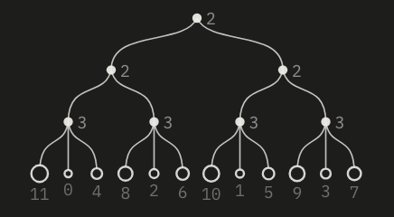
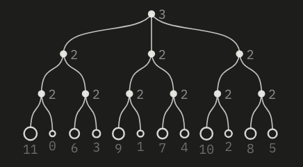

# Theory page source

`about.md` is the text of `../about.html`. Edit it in Obsidian (open this folder as a vault) or any editor, then rebuild:

```
node theory/build.mjs
```

This rewrites the table of contents and body of `about.html` and redraws the images in `figs/`. It needs Google Chrome installed. Set `CHROME=/path/to/chrome` if it lives somewhere else. `--no-figs` skips the images.

## Markdown

Plain markdown, plus:

- `==Density==` is a control name, drawn as a small key.
- `` `2·2·3` `` is monospace, used for strata and rank lists. A paragraph that is only a code span becomes a wide rank line.
- `## Heading` starts a numbered section and adds it to the contents.
- The first paragraph after `# Title` is the lede.

A figure is a callout. Put the images on one line, then a blank line, then the caption:

```
> [!figure]
>  
>
> **One cycle, two meters.** The caption.
```

Alt text is the label under each image. `![[name.png|label]]` works too.

## Figures

On the page, figures are drawn live by the machine's meter code. `figs.json` maps each image file name to what gets drawn: `{"fig": {...}, "style": "...", "mcols": 2}`. `fig` is the spec the page draws, with `type` set to flower, bloom, tree or strip. `style` is optional CSS for the canvas. `mcols` is optional and sets how many columns the figure uses on phones.

The PNGs are only previews for the editor. To change a figure, edit its entry in `figs.json` and rebuild. For a new figure, add an entry under a new file name, reference that name in `about.md`, and rebuild. The image appears after the build. An image with no entry in `figs.json`, like a photo, goes on the page as a plain image.
