**TL;DR key**

**The theory**

- **Indispensability** is Barlow's ranking of every pulse in a meter by how much the meter needs it to stay recognizable.
- **Cycle** is one full pass of a rhythm, a loop of equal steps that repeats.
- **Step** is one slot in a cycle that can trigger or stay silent.
- **Strata** are the layers of prime divisions that build a meter, so `2·2·3` is three strata.
- **Rank** is a step's place in the indispensability order, from N−1 for the downbeat down to 0.
- **Weight** is a step's rank scaled between 0 and 1.

**Drawings**

- **Tree** shows the meter as branches, with the whole cycle at the root and the steps as leaves sized by weight.
- **Flower** wraps the cycle into a circle where each petal is a step and its length is the step's weight.
- **Bloom** stacks every rhythm's flower as rings so you can see where they line up.

**Time**

- ==Tempo== sets beats per minute.
- ==Cycle== sets how many beats make one bar.
- **Length** is one rhythm's own cycle in beats, which can differ from the bar and needn't be whole.
- **Grid** is steps per beat, so steps equal length times grid.
- **Steps** sets the step count directly, and the meter then comes from its prime factors.
- **Polymeter** is rhythms of different lengths drifting apart and realigning at their least common multiple.

**Pattern**

- ==Density== sets how many steps play, turning them on strongest first.
- ==Mode== chooses hits by rank in Barlow mode or spreads them evenly in Euclid mode.
- ==Rotation== slides the hits around the cycle while the meter stays put.
- ==Lock== makes a rhythm avoid or join the hits of the same-length rhythms above it.
- ==Energy== pushes every rhythm's density up or down at once.
- ==Fill== adds more hits while held.

**Feel**

- ==Accent== sets how much weight decides velocity, from flat to the downbeat at full and the weakest step at 20%.
- ==Chance== is the probability that any hit plays on a given pass.
- ==Weak drop== makes low-weight steps skip more often than strong ones.
- ==Ghost== gives empty steps a chance of a very quiet hit, louder on stronger steps.
- ==Swing== delays every second step, up to half a step.
- ==Jitter== moves each hit early or late by a random few milliseconds.
- ==Vel jitter== randomly varies each hit's velocity.

**Motion**

- **Ratchet** splits one hit into several faster, quieter repeats inside its step.
- ==Ratchet chance== sets how often a ratchet happens, more often on weak steps.
- ==Spin== rotates the pattern by a few steps at the end of every cycle.
- ==Drift== nudges a rhythm's density, rotation or strata every few cycles.
- ==Drift steps== lets drift also change a rhythm's grid or step count.
- ==Drift every== sets how many cycles pass between drift moves.
- ==Mutate== does all of drift at once, with new strata, density, rotation and sometimes mode or lock.

**Sound**

- **Strokes** make conga, bongo and hat play open on strong steps, muted on middle steps and slapped on weak ones.
- **Pitch from weight** moves the note away from the root as weight drops, snapped to a scale.

# a drum machine with a particular theory of time

"Clarence" uses a particular conception of how time should be divided, how rhythm is felt, how to conceive of and modulate between divisions of a cycle. In any given meter, some pulses will matter more than others. Clarence Barlow derived a methodology for arriving at any given meter's hierarchy of beats. This doc hopes to explain the ranking system known as "Indispensibilty", where it comes from, and how each parameter controls variation in the resulting rhythmic patterns.

> [!figure]
> 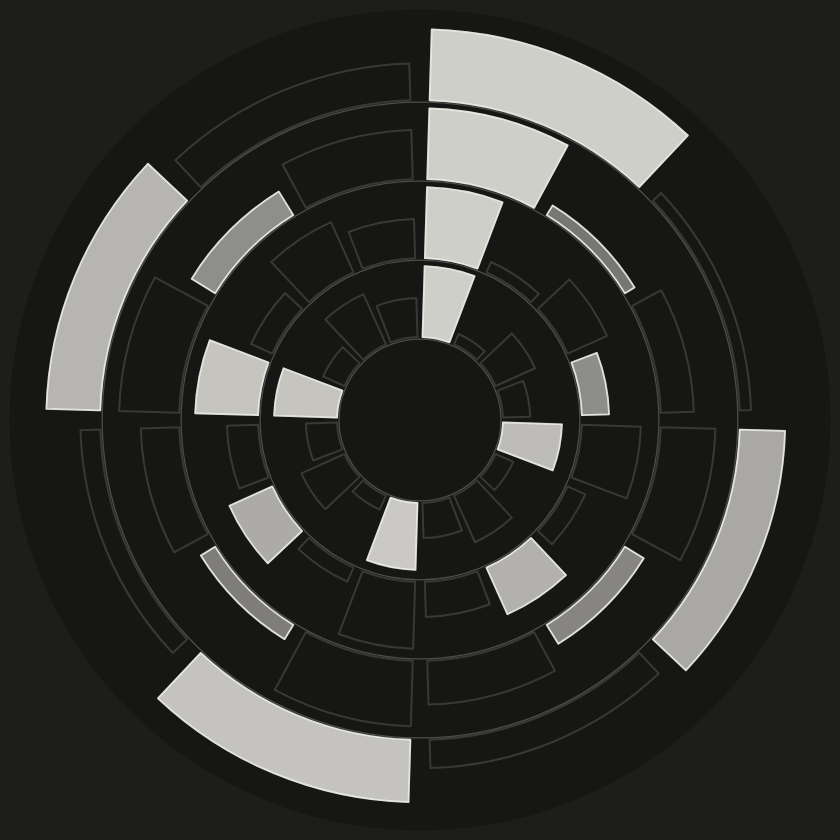
>
> **The Bloom, a Radial Chart Interface to Rhythmic Exploration.** Each ring represents a unique rhythm, one entire cycle read clockwise from the top. Petal length is proportional to the step's metric weight, and a filled in petal is a trigger for sounding.

## Clarence Barlow

Clarence Barlow was an influential composer and theorist in the world academic electronic music. Prolific teacher, he had great influence over the California computer music scene—Berkeley, Stanford, UCSC, UCSD. 

While composing rule-based music, Barlow began deriving rules around musical instinct. His first innovation here was a scoring mechanism for *how consonant is a harmonic interval*. While there's probably something to build here too, I was more interested in his second innovation:  **indispensability** or the measurement/ranking of every pulse within a meter—how much does the meter need that pulse to stay recognizable. At the extreme, the downbeat is all that's needed to punctuate the cycle of time. In more complex meters, such as 5/4, the measure can be divided into 2:3 or 3:2, each influences which pulses are indispensable to our perception of that meter. Barlow originally published the method in "Two Essays on Theory" in *Computer Music Journal* in 1987. 

This browser-based rhythm toy is based on that one formula, the circular layout is a nod to the "time is flat circle" meme.

## Dividing a cycle

A rhythm in the machine is a **cycle** of equal **steps** that repeats. Cycles can be divided in many different ways. Twelve steps can be heard as three groups of four, four groups of three, or two groups of six that each split again. Barlow describes this as a stack of division, but is also just prime factoring. The layers are called **strata**.

Twelve can be written as 2·2·3—three strata. The order of the primes describes the meter. `2·2·3` divides the cycle in half, each half in half again, and each quarter into three. That's four beats of triplets, a 12/8 feel. `3·2·2` divides the cycle into three beats of four sixteenths—a very different *feeling* rhythm.

> [!figure]
> 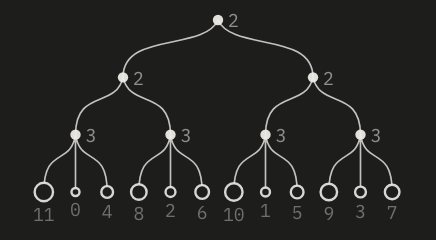 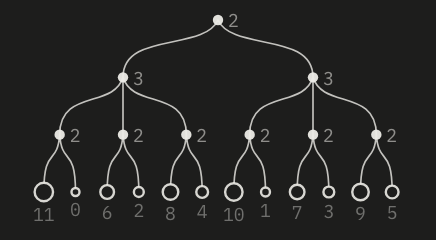 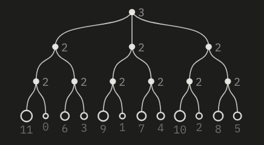
>
> **three different meters of the twelve beat cycle**. The leaves are the twelve steps, sized by weight and ranked beneath. The order of the strata *changes which steps are strong*. The biggest number is the strongest.

The machine picks the strata for you from ==Cycle== and ==Grid==. The beats of the cycle are the top strata, and the grid, which is steps per beat, divides each beat below them. Four beats on a grid of 4 gives `2·2·2·2`. Four beats on a grid of 3 gives `2·2·3`. You can reorder the primes, manually enabling variation, but also ==Drift== (a form of rhythm-specific randomness offered) will sometimes reorders them for you.

### Primes larger than three

Barlow gave fixed rankings for 2 and 3. A larger prime is first broken into groups of two with one three at the end, so 5 becomes 2+3 and 7 becomes 2+2+3, and those groups are ranked with the same method. This is why a cycle of five steps feels like a short-long pair and seven feels like short-short-long.

> [!figure]
>   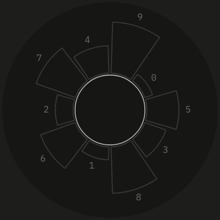
>
> **Odd meter examples** Petal length shows each step's weight. The number is its indispensability rank. Note: the downbeat is always the highest rank.

## Indispensability

Every step in a cycle of N steps gets a unique rank, from N−1 for the most indispensable down to 0. The downbeat always ranks highest. The rest follows from two rules applied one stratum at a time.

- **Coarse pulses keep their order.** When a stratum is added, the pulses that already existed stay above all the new ones, in the same order as before.
- **New pulses rank by where they sit and what comes next.** A new pulse first ranks by its position inside its group, using the small table for that prime. Ties go to the pulse that leads into the stronger coarse pulse.

For two pulses the table is `1 0`, so the downbeat beats the offbeat. For three it is `2 0 1`. The third pulse outranks the second because it leads into the next downbeat. That pull toward the next strong pulse is the heart of Barlow's idea, and it's a small rule that does a lot of work. It explains why the last eighth of a bar of four sounds like it belongs to the next bar.

Four beats as `2·2` ranks `3 0 2 1`. Beat one comes first, then beat three, then beat four because it leads into beat one, and beat two comes last. Sixteen steps as `2·2·2·2` ranks:

`15 0 8 4 12 2 10 6 14 1 9 5 13 3 11 7`

> [!figure]
> 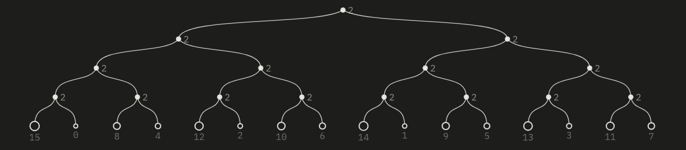
>
> **Sixteen steps, four strata of two.** The quarter notes carry the top four ranks, the eighths the next four, and the sixteenths the rest. Within each layer, the pulse that leads into a stronger one comes first.

The machine scales each rank to a **weight** between 0 and 1. Weight is the one number that most of the controls below read.

## Trees and flowers

A rhythm can be draw 2 ways, as a Flower or Tree (flower is a nice name for a radial diagram). 

The **tree** is displayed under each rhythm, showing the hierarchies of the meter. The root is the whole cycle, each branch point is a stratum, and the leaves are the steps, left to right in time. Leaf size is weight, a filled leaf trigger, and clicking a leaf manually toggles it on.

The **flower** is the same cycle wrapped into a circle, starting at the top and running clockwise. Each petal is a step and its length is the step's weight, so the shape of the empty flower is the meter itself. Filled petals play. Brightness is velocity (~loudness). A petal filled only partway plays only some of the time (representing chance as a subset of the whole). The Bloom stacks every rhythm's flower as rings so you can see where they line up.

> [!figure]
> 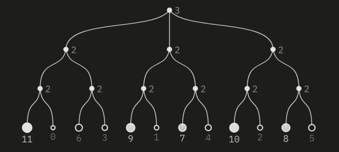 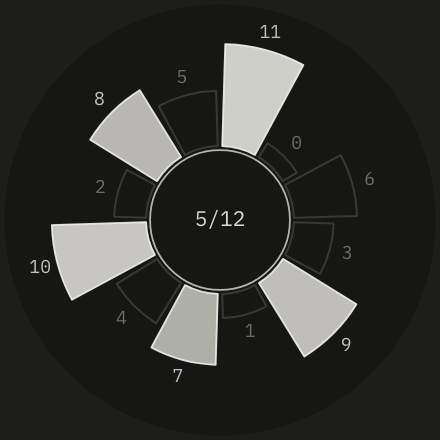
>
> **The same rhythm** Twelve steps as 3·2·2 with five hits (5 out of 12 *density*). The five strongest steps play, and in the flower they are the five longest petals.

## Cycles and time

The clock counts **beats**. ==Tempo== sets beats per minute and ==Cycle== sets how many beats make one bar. Each rhythm then has three numbers of its own.

- **Length** is the rhythm's cycle in beats. "Global" follows ==Cycle==. Any other value adjusts the rest locally to the particular rhythm.
- **Grid** is steps per beat. Steps = length × grid. The beat count is the numerator of the meter.
- **Steps** can also be set directly, deriving the rhythm from there. Its steps spread evenly over its length and the meter comes from the prime factors of the step count.

### Polymeter

When two rhythms have different lengths they drift against each other and line up again after the least common multiple of the two. A 3-beat rhythm against a 4-beat bar meets the bar again every 12 beats. A 6-beat bongo against a 2-beat conga meets every 6. A length of 8 against 4 gives half time.

> [!figure]
> 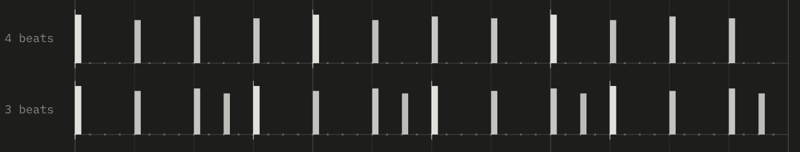
>
> **Three against four.** Twelve beats of time. The top rhythm repeats every 4 beats and the lower one every 3. The hairlines mark where each cycle starts. They only meet at the start, so the combined pattern is 12 beats long. The 4th beat of the 3-length cycle is the "pickup" to the cycle, derived from the indispensability weighting of the possible other 4th beats. 

### But not all Lengths are whole...

Lengths don't need to be whole numbers. A 2½-beat shaker against a five-beat bar plays twice per bar, and a 2½-beat shaker against four beats takes five bars to arrive at the top together. Each rhythm keeps its own meter independent from all other rhythms.

## Pattern

### Density

==Density== sets how many steps play. In Barlow mode the machine turns steps on in rank order, so one knob gives a family of patterns where each denser one contains every sparser one. At low density you hear only the downbeats. As you turn it up, the beats arrive, then the offbeats, then the pickups, which is roughly the order a drummer adds notes when building up. Density is the main control for any rhythm.

> [!figure]
> 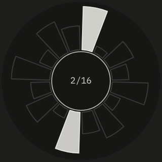 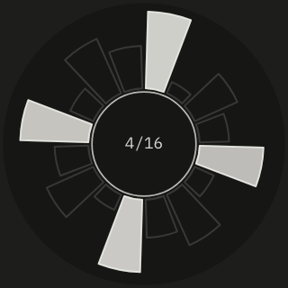 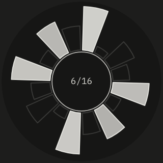 
>
> **Density in Barlow mode.** Each additional value to the pattern adds the next strongest steps. ==Energy== in the header pushes *every* rhythm's density up or down at once, and ==Fill== adds more while held.

### Barlow and Euclid

==Mode== picks how the hits are chosen. Barlow takes the strongest steps. Euclid spreads the same number of hits *as evenly as possible* over the cycle, which gives produces many traditional bell and clave patterns. Five hits in sixteen, for example, is four beats plus a pickup in Barlow mode and gaps of 4-3-3-3-3 in Euclid mode. Euclid **ignores** the meter when selecting steps, but the meter still sets the loudness/velocity of each hit.

> [!figure]
>  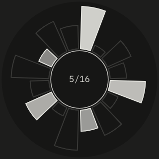 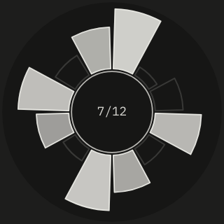 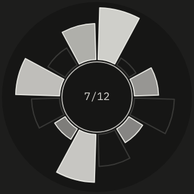
>
> **Modes of a feather** Left is Barlow, Right is Euclid. Euclid 7 in 12 is a rotation of the West African bell pattern used in bembé. Barlow 7 in 12 plays the four beats and the triplet notes that lead into three of them.

### Rotation

==Rotation== shifts the pattern around the cycle but *the meter does not move*. The petals keep their lengths, so a hit that was on a strong step lands on a weak one and gets quieter. Rotating a pattern changes both where its hits fall in the cycle and how they are accented.

> [!figure]
> 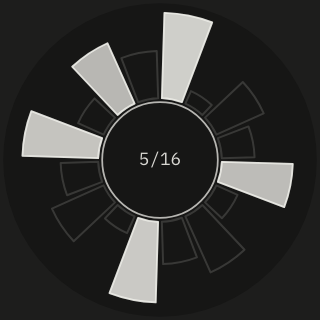 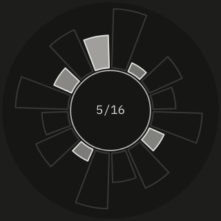 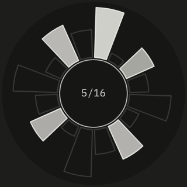 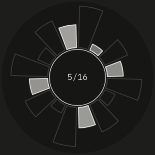
>
> **Rotating a pattern over a fixed meter.** While the fills move, the pedals stay the same length. Brightness stays a function of pedal weight. 

### Lock

==Lock== relates a rhythm to the ones above it in the rack. **Avoid** pushes steps where earlier rhythms already hit to the bottom of the ranking, so the rhythm fills the gaps and the parts interlock. **Join** pulls those steps to the top, so the rhythm doubles what is already there. Lock only compares rhythms with the same length.

> [!figure]
> 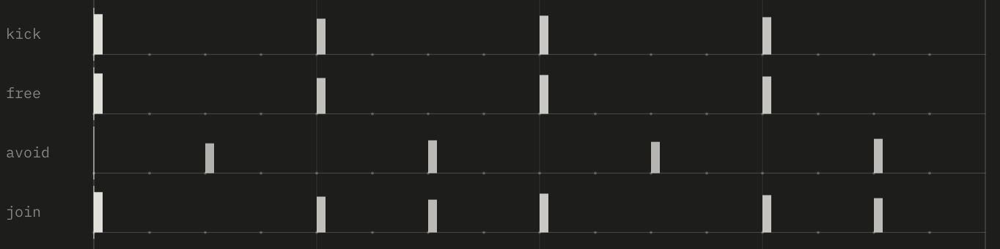
>
> **Lock against a kick.** With lock off, a second rhythm at the same density lands on the kick. Avoid moves it to *the next strongest free steps*. Join increases the higher density, adding to the kicks steps.

### Writing steps by hand

Click a petal or leaf to flip one step. The machine stores your edits relative to the pattern, so they rotate and spin with it, and density follows the number of hits you leave but doesn't override your pattern placement.

## Feel

A pattern determines *which steps play*. Feel is a function of *how they play*. Almost all of the controls read a step's weight, so the meter shape has disproportionate impact on the performance of the pattern.

### Accent

==Accent== sets how much weight decides loudness. At 0 every hit is equally loud. At 100% the downbeat is at full volume and the weakest step plays at 20%. This is what "humanizes" the pattern.

> [!figure]
> 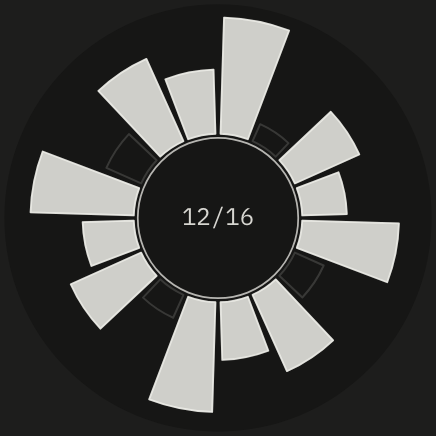 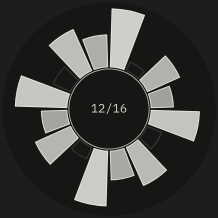 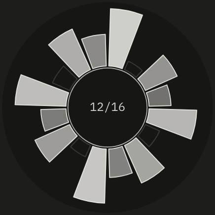
>
> **Accent.** Fill brightness is loudness/velocity.

### Chance and weak drop

==Chance== is the probability that a hit plays on any given pass. ==Weak drop== makes that probability depend on weight in particular, skipping lower priority/weighted notes instead of the downbeat (statistically). Playing with both of these parameters prevents a dense pattern from sounding like a loop (subtle variations throughout the cycles). In the flower, a petal filled partway represents the statistical likelihood of how often that step plays.

> [!figure]
> 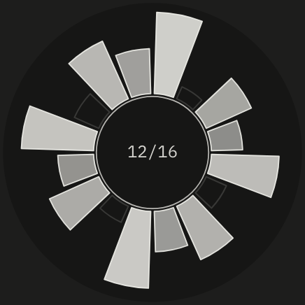 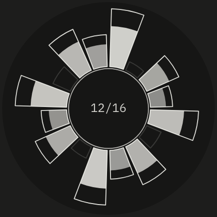 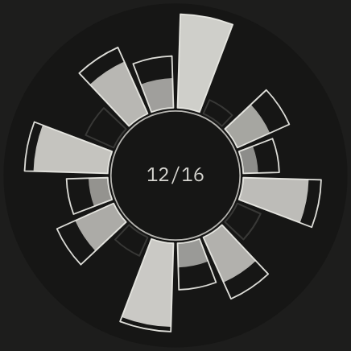
>
> **Probability as fill.** Chance shortens every fill equally, likelihood across the whole. Weak drop decreases probability of the lower ranked pedals in inverse proportionality.

### Ghost notes

==Ghost== gives every empty step a chance of a very quiet hit. Ghost notes are the soft strokes between the main ones that make a groove feel alive. Traditionally, hand drums play them as heel strokes. The flower shows them as short stubs in the empty petals. The weight of the pedal proportionally controls the volume of the ghost note, keeping with the underlying accent/emphasis schema. 

### Swing and jitter

==Swing== delays every second step, up to half a step. A small amount loosens straight sixteenths. Two thirds is a triplet shuffle and 100% is a dotted rhythm. 

==Jitter== moves each hit early or late by a *random* few milliseconds. ==Vel jitter== (velocity jitter) does the same for loudness.

> [!figure]
> 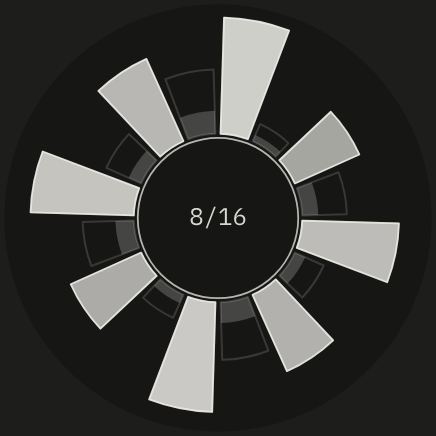 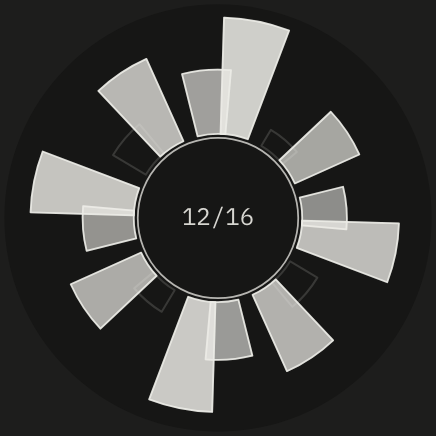 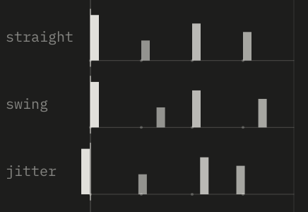
>
> **Ghosts and timing.** Ghost notes appear as stubs in empty petals. Swing pushes every second petal clockwise. The strip zooms in on one beat of sixteenths.

## Motion

Motion controls change the rhythm while it plays, either inside a step or from one cycle to the next.

### Ratchet

A **ratchet** splits one hit into several faster ones inside its step, each quieter than the last, creating a microrhythm. A ratchet is a new stratum of division that shows up for single step. 
==Ratchet chance== sets how often it happens, and *weak steps ratchet more than strong ones*, so rolls tend to lead into strong beats instead of undermining them. 
==Ratchet== sets how many repeats. 2 doubles the step and 3 turns it into a triplet.

> [!figure]
> 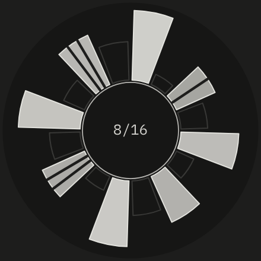 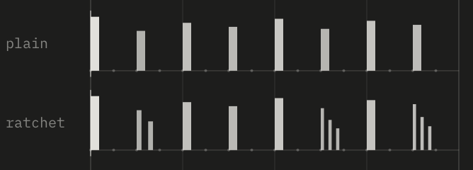
>
> **Ratchets.**  Each ratchet repeat is shorter and quieter than the one before.

### Spin

==Spin== rotates the pattern by a few steps at the end of every cycle. A pattern that spins moves through all its rotations and comes back, passing over different accents each time. Placing a spinning copy against the original produces Steve Reich-style *phasing*.

The Phase preset does this with the figure from *Clapping Music*.

> [!figure]
> 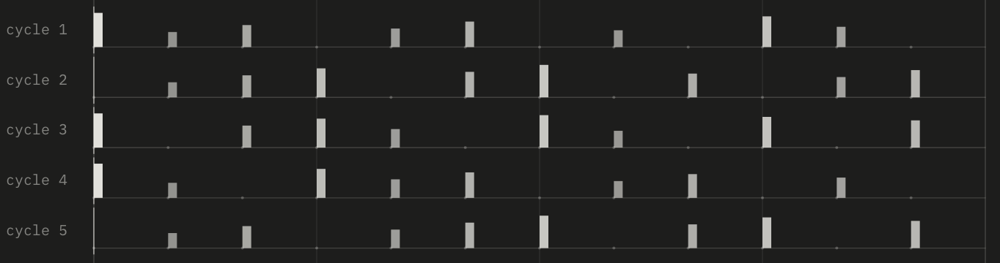
>
> **Spin +1 for five cycles.** The Clapping Music figure moves one step later each cycle. The meter stays put, so the loudness of each hit changes as it moves.

### Drift

==Drift== lets a rhythm wander. Every few cycles it nudges density up or down, sometimes rotates a step, and sometimes reorders its strata. 
With ==Drift steps== on it can also change its grid or step count.
==Drift every== in the global settings (header) sets how often drift occurs.

> [!figure]
> 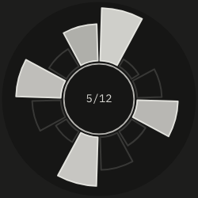 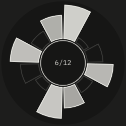 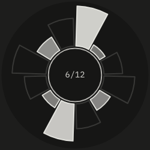 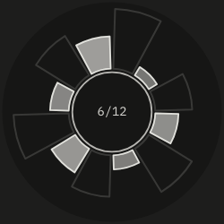 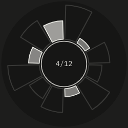
>
> **Four drift moves.** A single rhythm wandering over several drift points.

==Mutate== is all of drift at once. It picks new strata, density and rotation, and sometimes a new mode or lock. <kbd>M</kbd> mutates everything and <kbd>⇧Q</kbd>–<kbd>⇧I</kbd> mutates one rhythm in isolation (good for performance/play).

## Sound from weight

Instruments are separate from rhythms. Any rhythm can play any instrument (see instrument rack at the bottom). 

Some instrument controls also read the weight of the step being played:
- **Strokes.** Conga, bongo and hat change how they're struck. Strong steps play open, middle steps muted and weak steps slapped, so one pattern gets the tonal range of a hand drummer.
- **Pitch from weight.** The pitch moves away from the base note as weight drops, snapped to a scale. Strong steps sit on the root while weak steps move away. Melody follows meter!
- **Pitch from velocity, step or chance.** Loudness, position in the cycle, or a random number, all drive the velocity mapping.